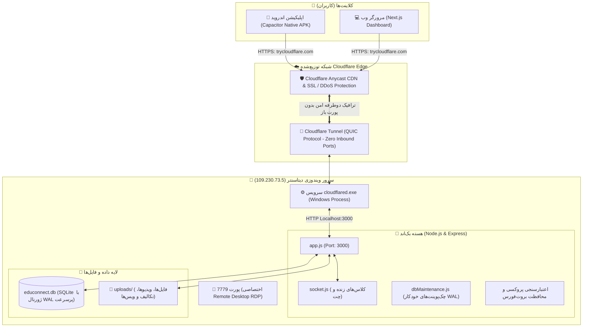
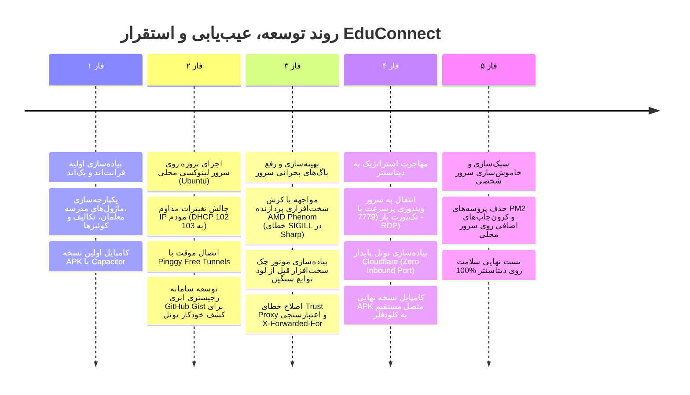

# 🗺️ نقشه جامع صفر تا صد معماری، ابزارها و مسیر توسعه پروژه EduConnect

> **سامانه یکپارچه و هوشمند ارتباطی و مدیریتی مدارس (نسخه Enterprise)**  
> تاریخ مستندسازی: پاییز ۲۰۲۶  
> نگارش: ۱.۲.۰  

---

## 📌 فهرست مطالب
1. [نمای کلی و معماری سیستم](#-۱-نمای-کلی-و-معماری-سیستم)
2. [پشته فنی کامل (Tech Stack)](#-۲-پشته-فنی-کامل-tech-stack)
3. [گاه‌شمار گام‌به‌گام مسیر طی‌شده (از آغاز تا دیتاسنتر)](#-۳-گاه‌شمار-گام‌به‌گام-مسیر-طی‌شده)
4. [چالش‌های پیچیده مهندسی و نحوه رفع آن‌ها](#-۴-چالش‌های-پیچیده-مهندسی-و-نحوه-رفع-آن‌ها)
5. [جدول جامع تمام ابزارها، پکیج‌ها و پروتکل‌ها](#-۵-جدول-جامع-تمام-ابزارها-پکیج‌ها-و-پروتکل‌ها)
6. [ساختار فایل‌ها و اسکریپت‌های کلیدی پروژه](#-۶-ساختار-فایل‌ها-و-اسکریپت‌های-کلیدی-پروژه)
7. [راهنمای نگهداری و راه‌اندازی سریع در آینده](#-۷-راهنمای-نگهداری-و-راه‌اندازی-سریع-در-آینده)

---

## 🏗️ ۱. نمای کلی و معماری سیستم

معماری سامانه EduConnect به‌گونه‌ای طراحی شده که ارتباطی پایدار، ایمن، با کمترین تاخیر (Low Latency) و سازگار با اینترنت ایران (همراه و ثابت) بین کادر آموزشی، اولیا و دانش‌آموزان برقرار سازد.

### دیاگرام جریان داده و زیرساخت نهایی (دیتاسنتر):



---

## 🛠️ ۲. پشته فنی کامل (Tech Stack)

### ۲.۱. بخش کلاینت و فرانت‌اند (Frontend)
- **Next.js (App Router)**: معماری مدرن React با کامپوننت‌های بهینه‌سازی‌شده برای دسکتاپ و موبایل.
- **Turbopack Compiler**: بیلد سریع و کامپایل لحظه‌ای کدهای جاوااسکریپت.
- **Tailwind CSS & CSS Modules**: طراحی کاملاً ریسپانسیو سازگار با انواع ابعاد نمایشگر (موبایل، تبلت و کامپیوتر).
- **Zustand**: مدیریت سراسری و بهینه وضعیت نشست و اطلاعات ورود کاربران (`authStore.js`).
- **Axios**: کلاینت ارتباط با API مجهز به Failover خودکار و بازنشانی توکن‌های منقضی (`api.js`).
- **React Hot Toast**: سیستم مدرن نوتیفیکیشن و اطلاع‌رسانی وضعیت اتصال سرور.
- **React Icons / Lucide**: آیکون‌های برداری سبک و یکپارچه.

### ۲.۲. پکیج نیتیو اندروید (Mobile Container)
- **Capacitor 8 (Ionic)**: تبدیل خروجی استاتیک وب به پکیج کامپایل‌شده بومی اندروید.
- **Android Gradle Plugin & SDK 34/35**: معماری بیلد مدرن اندروید.
- **Java 17 LTS**: محیط کامپایل و ران‌تایم ابزارهای نیتیو اندروید.
- **Network Security Config**: اعتبارسنجی ترافیک دامنه کلودفلر، پینگی و شبکه محلی به همراه پشتیبانی از Cleartext در صورت نیاز.

### ۲.۳. سرور و بک‌اند (Backend)
- **Node.js**: موتور پردازشی سرور.
- **Express.js**: فریم‌ورک ماژولار ساخت API RESTful.
- **Knex.js**: لایه Query Builder جهت ارتباط بهینه با دیتابیس و مدیریت ورژن‌بندی دیتابیس (Migrations & Seeds).
- **SQLite3 / Better-SQLite3**: دیتابیس رابطه‌ای تعبیه‌شده با فعال‌سازی مُد **WAL (Write-Ahead Logging)** و همزمانی بالا جهت صفر کردن احتمال قفل‌شدگی دیتابیس.
- **Socket.IO**: ارتباطات دوطرفه Real-time برای رویدادهای زنده کلاس، پیام‌رسانی و نوتیفیکیشن‌ها.
- **Helmet & Compression**: ایمن‌سازی هدرهای امنیتی HTTP و فشرده‌سازی Gzip پاسخ‌ها برای مصرف بهینه اینترنت.
- **Express Rate Limit**: محدودسازی درخواست‌ها جهت جلوگیری از حملات Brute-Force و سرریز منابع سرور.

### ۲.۴. شبکه، تونل‌سازی و زیرساخت (DevOps & Networking)
- **Cloudflare Tunnel (`cloudflared`)**: معماری مدرن برقراری تونل بدون نیاز به هیچ پورت باز ورودی (Zero-Inbound Port Forwarding).
- **Pinggy SSH Tunneling**: ابزار جانبی فوروارد سریع ترافیک با رمزنگاری TCP/SSH.
- **PM2**: مدیر فرآیند پس‌زمینه (Process Manager) با قابلیت راه‌اندازی مجدد خودکار در صورت بروز خطای سیستمی.
- **GitHub Gist Registry**: رجیستری ابری جهت ذخیره داینامیک آدرس‌های لایو به عنوان فال‌بک.

---

## ⏳ ۳. گاه‌شمار گام‌به‌گام مسیر طی‌شده



---

## 🔬 ۴. چالش‌های پیچیده مهندسی و نحوه رفع آن‌ها

### ۱. چالش خطای سخت‌افزاری `Illegal instruction (SIGILL)`
- **صورت مسئله:** روی سرور شخصی اوبونتو (پردازنده نسل قدیمی AMD Phenom II X4)، به محض اجرای بک‌اند، برنامه با سیگنال `SIGILL` از طرف کرنل لینوکس کشته می‌شد و بیش از ۷۰۰ بار ریستارت می‌خورد.
- **ریشه‌یابی:** پکیج جدید `sharp` (مخصوص فشرده‌سازی عکس) از کتابخانه باینری `libvips` استفاده می‌کرد که با دستورات مدرن برداری (SSSE3/AVX) کامپایل شده است؛ در حالی که این پردازنده فاقد این فلگ‌ها بود. چون SIGILL یک سیگنال سخت‌افزاری غیرقابل Try/Catch در جاوااسکریپت است، کل پروسه منهدم می‌شد.
- **راهکار خلاقانه:** در فایل [upload.routes.js](file:///d:/project/school%20app/school%20app/backend/src/modules/upload/upload.routes.js)، مکانیزم اعتبارسنجی زنده پردازنده با خواندن `/proc/cpuinfo` قرار داده شد. در صورتی که پردازنده فاقد دستورالعمل‌های مورد نیاز باشد، ماژول `sharp` به صورت Safe بای‌پس شده و ذخیره‌سازی فایل بدون کرش انجام می‌گردد.

### ۲. چالش محدودیت تک‌پورت در سرور دیتاسنتر (فقط پورت ۷۷۷۹ باز بود)
- **صورت مسئله:** سرور دیتاسنتر ویندوزی خریداری‌شده فقط دارای یک پورت باز (`7779`) بود که برای ریموت دسکتاپ (RDP) تنظیم شده بود. امکان باز کردن پورت‌های استاندارد 80 و 443 یا 3000 در فایروال سخت‌افزاری دیتاسنتر وجود نداشت.
- **راهکار اساسی:** استفاده از فناوری **Cloudflare Tunnel (`cloudflared`)**. این فناوری هیچ پورت ورودی باز نیاز ندارد؛ بلکه از داخل سرور یک کانال دوطرفه امن بر پایه پروتکل پیشرفته QUIC به نزدیک‌ترین لبه اینترنت کلودفلر باز می‌کند و ترافیک اپلیکیشن موبایل را بدون قطعی تحویل سرور می‌دهد.

### ۳. چالش انکودینگ کاراکترهای فارسی در فایل‌های Batch ویندوز
- **صورت مسئله:** در هنگام اجرای اسکریپت‌های `.bat` روی ویندوز سرور، خط فرمان ویندوز (`cmd.exe`) به دلیل تداخل انکودینگ حروف فارسی (مانند «راه‌اندازی» یا «پکیج‌های پیش‌نیاز») عبارات را به عنوان دستور تلقی می‌کرد و دستورات اصلی از جمله `npm install` رد می‌شدند.
- **راهکار:** بازنویسی ۱۰۰٪ فایل‌های اجرای خودکار [run_backend.bat](file:///d:/project/school%20app/school%20app/backend/run_backend.bat) و [run_tunnel.bat](file:///d:/project/school%20app/school%20app/backend/run_tunnel.bat) با ساختار استاندارد ASCII بین‌المللی.

### ۴. چالش تشخیص و سوئیچ خودکار سرور در اپلیکیشن موبایل (Zero Configuration)
- **صورت مسئله:** کاربران معمولی (معلمان و اولیا) توانایی وارد کردن دستی آدرس IP یا لینک‌های تونل را ندارند.
- **راهکار:** در فایل [api.js](file:///d:/project/school%20app/school%20app/frontend/src/lib/api.js)، یک پایپ‌لاین تشخیص خودکار و موازی پیاده‌سازی شد که در صورت قطع ارتباط:
  1. ابتدا آدرس‌های شبکه داخلی وای‌فای مدرسه را پینگ می‌کند.
  2. در صورت عدم دسترسی، به تونل دیتاسنتر کلودفلر متصل می‌شود.
  3. در صورت تغییر تونل، آدرس زنده را در پس‌زمینه از رجیستری ابری Gist دریافت کرده و اعمال می‌کند.

---

## 📊 ۵. جدول جامع تمام ابزارها، پکیج‌ها و پروتکل‌ها

| دسته‌بندی | نام ابزار / پکیج | نسخه / وضعیت | شرح کاربرد در این پروژه |
| :--- | :--- | :--- | :--- |
| **فرانت‌اند** | `next` | 16.3.6 (Turbopack) | فریم‌ورک اصلی صفحات و داشبورد مدرن سامانه |
| | `react` / `react-dom` | 19.x | کتابخانه رابط کاربری و رندر کامپوننت‌ها |
| | `zustand` | ^4.5.5 | مدیریت وضعیت کلاینت و ذخیره اطلاعات سشن |
| | `axios` | ^1.7.7 | ارسال درخواست‌های HTTP به همراه اینترسپتور بازنشانی خودکار توکن |
| | `react-hot-toast` | ^2.4.1 | نمایش بنرها و پیام‌های وضعیت سیستم |
| **موبایل** | `@capacitor/core` & `cli` | 8.x | تبدیل و بیلد برنامه وب برای سیستم‌عامل اندروید |
| | `@capacitor/app` | 8.1.2 | مدیریت رویدادهای سیستم‌عامل، بسته‌شدن و بازگشت برنامه |
| | `Gradle` | 8.14.3 | سیستم بیلد و مدیریت وابستگی‌های نیتیو اندروید |
| **بک‌اند** | `express` | ^4.21.0 | فریم‌ورک اصلی اجرای سرور API |
| | `knex` | ^3.3.0 | SQL Query Builder و مدیریت مایگریشن جداول دیتابیس |
| | `better-sqlite3` | ^13.0.3 | موتور دیتابیس بسیار پرسرعت با پشتیبانی از WAL |
| | `socket.io` | ^4.7.5 | برقراری وب‌سوکت برای چت زنده و تخته‌سیاه کلاسی |
| | `jsonwebtoken` | ^9.0.2 | صدور و اعتبارسنجی توکن‌های احراز هویت (JWT) |
| | `bcryptjs` | ^2.4.3 | هش‌کردن امن رمزهای عبور کاربران |
| | `helmet` | ^7.1.0 | تقویت امنیت هدرهای HTTP و جلوگیری از XSS و Clickjacking |
| | `express-rate-limit` | ^7.4.0 | جلوگیری از ارسال درخواست‌های بیش از حد و اتک‌های بروت‌فورس |
| | `multer` | ^1.4.5-lts.1 | دریافت و ذخیره‌سازی فایل‌های بارگذاری‌شده در سرور |
| | `compression` | ^1.8.2 | فشرده‌سازی ریسپانس‌های HTTP با الگوریتم Gzip |
| **زیرساخت** | `cloudflared` | 2026.10.x | تونل پایدار، بدون پورت باز و با HTTPS خودکار کلودفلر |
| | `OpenSSH` | استاندارد | اتصال ریموت و اجرای پروسه‌های خودکار در سرور |
| | `PM2` | 5.x | مدیریت فرآیندهای پس‌زمینه در محیط سرور |
| | `mstsc` (RDP) | استاندارد ویندوز | اتصال و کنترل گرافیکی ویندوز سرور از راه دور |

---

## 📂 ۶. ساختار فایل‌ها و اسکریپت‌های کلیدی پروژه

```text
d:\project\school app\
├── EduConnect.apk                          # فایل نصبی نهایی اندروید متصل به سرور دیتاسنتر
├── EduConnect-WindowsServer.zip             # پکیج کامل سرور جهت استقرار سریع روی هر ویندوز
├── PROJECT_ROADMAP.md                      # همین مستند جامع (راهنمای فنی پروژه)
└── school app/
    ├── backend/                            # کدهای سمت سرور (Node.js API)
    │   ├── src/
    │   │   ├── app.js                      # هسته اصلی سرور، کانفیگ روت‌ها و میدل‌ورها
    │   │   ├── socket.js                   # وب‌سوکت برای رویدادهای بلادرنگ
    │   │   ├── config/                     # تنظیمات دیتابیس (Knexfile) و متغیرهای محیطی
    │   │   ├── modules/                    # ماژول‌های سامانه (احراز هویت، کلاس، تکالیف و...)
    │   │   └── services/                   # سرویس‌های نگهداشت دیتابیس (WAL Checkpoint)
    │   ├── educonnect.db                   # فایل دیتابیس اصلی برنامه
    │   ├── run_backend.bat                 # اسکریپت راه‌اندازی ۱-کلیکه سرور در ویندوز
    │   ├── run_tunnel.bat                  # اسکریپت اجرای خودکار تونل کلودفلر در ویندوز
    │   └── package.json                    # وابستگی‌ها و پکیج‌های نودجی‌اس
    │
    ├── frontend/                           # کدهای سمت کلاینت (Next.js & Capacitor)
    │   ├── src/
    │   │   ├── app/                        # صفحات و روت‌های اپلیکیشن (داشبورد، لاگین و...)
    │   │   ├── components/system/          # کامپوننت‌های اتصال سرور و چک‌کننده آپدیت
    │   │   │   ├── ServerConnectionBar.js  # نوار هوشمند وضعیت اتصال سرور
    │   │   │   └── AutoUpdateChecker.js    # سیستم مدیریت به‌روزرسانی‌های نسخه سرور
    │   │   └── lib/api.js                  # موتور اتصال Axios با آدرس‌های پیش‌فرض
    │   ├── android/                        # پروژه اندروید بومی (Android Studio / Gradle)
    │   └── capacitor.config.ts             # تنظیمات کانتینر اندروید کاپاسیتور
    │
    └── Deploy-Windows-Server.ps1           # اسکریپت پاورشل راه‌اندازی اتوماتیک روی سرور جدید
```

---

## 💡 ۷. راهنمای نگهداری و راه‌اندازی سریع در آینده

### الف) اگر ویندوز سرور ریستارت شد چه کنیم؟
1. با Remote Desktop وارد سرور شوید (`109.230.73.5:7779`).
2. داخل پوشه پروژه روی دو فایل زیر دابل‌کلیک کنید:
   - فایل **`run_backend.bat`** (روشن‌کردن سرور بک‌اند روی پورت ۳۰۰۰)
   - فایل **`run_tunnel.bat`** (روشن‌کردن مجدد تونل کلودفلر)

### ب) اگر خواستید تغییری در کدهای بک‌اند بدهید:
1. فایل مربوطه را در مسیر `backend/src` تغییر دهید.
2. پنجره بک‌اند را ببندید و مجدداً `run_backend.bat` را اجرا کنید؛ تمام کدهای جدید بلافاصله بارگذاری می‌شوند.

### ج) نحوه بک‌آپ‌گیری از اطلاعات دانش‌آموزان و مدارس:
تنها کافی است از فایل **`educonnect.db`** داخل پوشه `backend` یک کپی تهیه کنید؛ تمام اطلاعات، کاربران، نمرات، کلاس‌ها و چت‌ها درون همین فایل ذخیره هستند.

---
*تهیه‌شده توسط تیم مهندسی دستیار هوشمند توسعه Antigravity — پاییز ۲۰۲۶*

